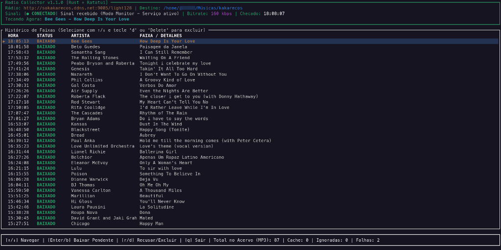

# Radio Collector (Rust + TUI)

*Read this in [Português (Brasil)](README.pt-BR.md).*

An autonomous and intelligent online radio stream track collector written in **Rust**.



Rather than ripping continuous, lossy radio audio streams riddled with station jingles, voiceovers, and ads, **Radio Collector** monitors ICY metadata in real time and retrieves the official, uncompressed studio version in **MP3 320 kbps (48 kHz)** directly from catalog sources (YouTube Music). It embeds high-resolution album artwork and complete ID3 tags automatically.

---

## Key Features

* **Interactive Terminal UI (`ratatui`)**: Real-time terminal dashboard featuring current track monitoring, discrete state transitions, complete catalog history with bounded pagination (`PageUp`/`PageDown`/`Home`/`End`), interactive retry for failed tracks (`[t]`), manual download of pending items (`[Enter/b]`), deletion modals (`[d]`), and filesystem-synchronized counters.
* **Smart Dual-Mode Architecture**:
  * **Interactive TUI Mode**: Ran directly in the terminal for monitoring and management. Automatically detects if the background `systemd` daemon is running and enters **Monitor Mode** without firing duplicate downloads.
  * **Headless Daemon Mode (`--daemon`)**: Runs 24/7 in the background via `systemd` without rendering a UI, producing structured logs directly to `journald`.
* **Zero Bandwidth Waste**: Connects to the Icecast/SHOUTcast stream, reads only the metadata headers and ICY track title interval, and immediately disconnects (~1 KB per poll).
* **2-Tier Intelligent Deduplication**:
  * **Embedded SQLite Database**: Persistent history with case-insensitive normalization and whitespace stripping (WAL mode). Obsolete failure records are automatically purged upon successful download.
  * **Physical Filesystem Reconciliation**: Automatically inspects destination directories on startup to heal database records and prevent redundant downloads.
* **Resilient Search & Retrieval**:
  * Direct YouTube Music catalog search with multi-candidate fallback (`ytsearch5:`) and age-gate bypass mechanisms.
  * Optional YouTube cookies support (`cookies_file`) for restricted tracks.
* **Configurable Station Filter**: Customizable regex patterns to identify and discard promos, ads, station IDs, and invalid titles.
* **Extraction Resilience & Failure Safeguards**:
  * Automatically converts WebP thumbnails to JPEG format before ID3 injection (preventing `ffprobe` post-processing crashes).
  * Cleans up orphaned temporary files (`.webm`, `.webp`, `.part`) on aborted or failed operations.

---

## Project Structure

```
radio-collector/
├── Cargo.toml               # Rust manifest and dependencies
├── config.toml              # Default configuration template
├── radio-collector.service  # Systemd background service unit
├── INSTALL.md               # Installation & compilation guide (English)
├── INSTALL.pt-BR.md         # Installation & compilation guide (pt-BR)
├── README.md                # Usage & architecture guide (English)
├── README.pt-BR.md          # Usage & architecture guide (pt-BR)
└── src/
    ├── main.rs              # Entry point, worker detection, and dynamic mode transition
    ├── config.rs            # Strongly-typed configuration parser
    ├── db.rs                # SQLite layer with WAL mode, reconciliation, and deduplication
    ├── downloader.rs        # Async yt-dlp orchestrator with progress streaming & JPEG conversion
    ├── events.rs            # Event types passed across worker and UI threads
    ├── filter.rs            # Station jingle filter & regex engine
    ├── icy.rs               # Async TCP client for ICY metadata parsing
    └── tui.rs               # Terminal User Interface powered by Ratatui
```

---

## Usage

### 1. Interactive TUI Mode
To open the interactive dashboard in your terminal or SSH session:

```bash
# Uses /etc/radio-collector/config.toml (or ./config.toml) automatically
radio-collector

# Or specify a custom configuration file:
radio-collector --config /path/to/custom_config.toml
```

#### Keyboard Shortcuts:
* **`↑` / `↓`** (or **`k` / `j`**): Navigate and select tracks in the history table with the cursor indicator (`▶`). Scrolling stops cleanly at table boundaries (no circular looping).
* **`PageUp` / `PageDown`**: Jump 15 tracks up or down for fast library navigation.
* **`Home` / `End`**: Jump directly to the newest (top) or oldest (bottom) track.
* **`t`** or **`T`**: Retry downloading the selected failed (`FALHA`) or pending (`PENDENTE`) track immediately in the background. Automatically updates status to `BAIXANDO` and reconciles counters upon completion.
* **`Enter`** or **`b`**: Download the selected pending (`PENDENTE`) track.
* **`d`** or **`Delete`**: Open floating confirmation modal to safely delete the selected track from both SQLite and the filesystem (`[S]` confirms deletion, `[N]` or `Esc` cancels).
* **`q`** or **`Esc`**: Gracefully exit the application and restore terminal state.

---

### 2. Headless Daemon Mode (Background / Server)
To run autonomously in the background (as a systemd service):

```bash
radio-collector --daemon
```

In daemon mode, the graphical UI is disabled and events are emitted as structured logs:
```text
[*] Radio Collector started in DAEMON mode (Config: "/etc/radio-collector/config.toml")
[*] Monitoring: http://sokakarecos.ddns.net:9005/light128
[*] Audio Destination: /var/musicas
[NOW PLAYING] Radio broadcasting: 'Bee Gees - Love So Right'
[DOWNLOAD] Starting studio search and download at 320k: 'Bee Gees - Love So Right'
[SUCCESS] Track saved with artwork and ID3 tags: 'Bee Gees - Love So Right'
```

---

## Configuration (`/etc/radio-collector/config.toml`)

Behavior is fully customizable via TOML:

```toml
[stream]
url = "http://sokakarecos.ddns.net:9005/light128" # Radio stream URL
user_agent = "VLC/3.0.18 LibVLC/3.0.18"          # HTTP User-Agent
check_interval_seconds = 30                       # Stream polling interval
timeout_seconds = 10                              # ICY connection timeout

[storage]
output_dir = "/var/musicas"                       # Final MP3 destination folder
db_path = "/var/lib/radio-collector/musicas.db"   # SQLite database path

[download]
ytdlp_path = "/usr/local/bin/yt-dlp"              # yt-dlp binary path
audio_format = "mp3"                              # Output audio format
audio_quality = "0"                               # VBR 0 (~320 kbps)
timeout_seconds = 180                             # Download timeout per track
embed_metadata = true                             # Embed ID3 tags (artist, title)
embed_thumbnail = true                            # Embed album artwork
auto_download = true                              # Download automatically (true) or queue as PENDING (false)
# cookies_file = "/etc/radio-collector/cookies.txt" # Optional cookies file for age-restricted / authenticated tracks

[filter]
min_title_length = 4                              # Minimum title length
require_hyphen = true                             # Enforce "Artist - Title" format
ignore_patterns = [                               # Regex patterns to ignore
    "station_jingle",
    "commercial",
    "station_id",
]

[ui]
tui = true                                        # Enable TUI by default in terminal
```

---

## System Requirements

* **Linux**: Debian 13 (Trixie) or any modern x86_64 / aarch64 distribution.
* **`yt-dlp`**: Installed at `/usr/local/bin/yt-dlp` (or custom path in `config.toml`).
* **`ffmpeg`**: Required on the host for audio transcoding and thumbnail conversion.
* **`nodejs`**: Required JavaScript runtime for YouTube signature deciphering (EJS / n-sig).
